# Отчёт по лабораторной работе №3 (Bubble)

**Студент:** Шило Денис  
**Группа:** УИР-241  
**Дата:** 09.10.2026

**Тема:** Дневник питания  
**Ачивка:** 2 

---

## Часть 1. Промпт и генерация каркаса

### Промпт (дословно)

```
Создай приложение на тему «Дневник питания»

Пусть этот сайт требует регистрацию: у каждого пользователя свой 
личный дневник питания, он видит только свои записи

Страницу обязательно создай по структуре header + body + footer

Обязательно укажи в заготовке следующую строку: «ТВП: Шило»

Добавь несколько интерактивных элементов (реализующих CRUD):
список приёмов пищи за день, форму добавления блюда с полями 
(название, тип приёма, калории, белки, жиры, углеводы, дата, 
полезность, заметки), кнопки редактирования и удаления, 
счётчик калорий за день
```

### Результат генерации

ИИ сгенерировал 7 страниц, на главной изображено требование регистрации, также немного рассказано о проекте

### Скриншот

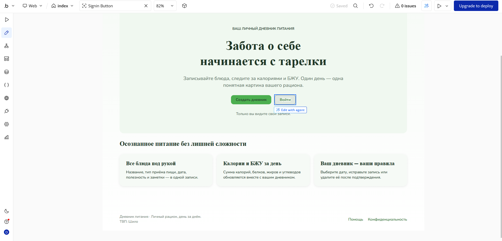

## Часть 2. Исследование идеи

### Изученные источники

**Источник:** Шаблон Bubble / Build Guide
- **Что посмотрел:** шаблон одного из пользователей с проектом схожей тематики.
- **Что показалось полезным:** навигация сверху с логотипом, ссылками и кнопками входа/регистрации — стандартный паттерн для веб-приложений.
- **Что взял в приложение:** верхнюю навигационную панель с логотипом, ссылками на разделы и кнопками Sign up / Log in.

### Скриншоты

**Идея (из шаблона):**
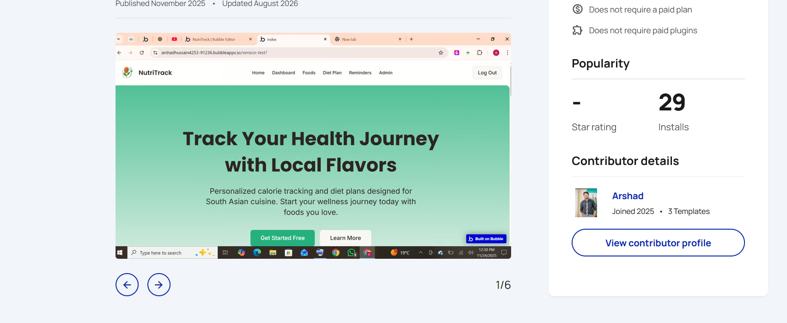

**Реализация в моём приложении:**
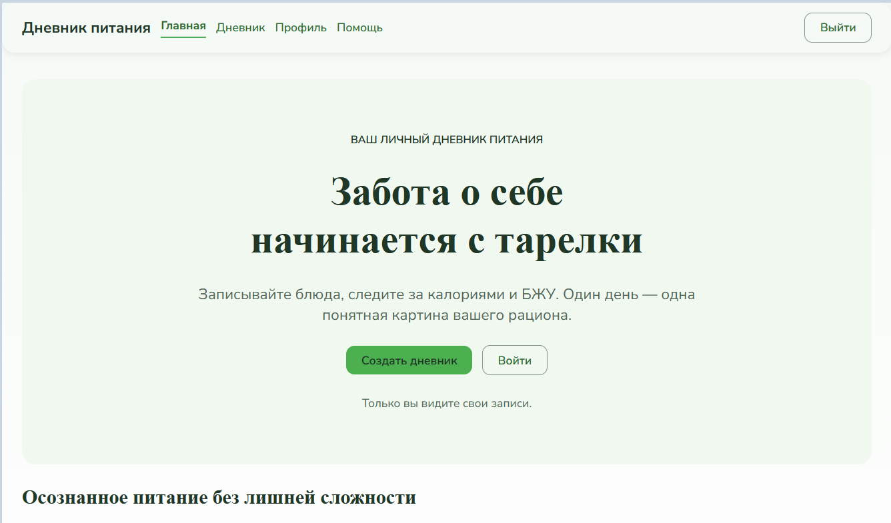

## Часть 3. Ручная доработка UI

### 3.1. Изменение текста заголовка

Заголовок страницы изменён вручную. Текст «Дневник питания» дополнен именем студента.

### 3.2. Global variable для цвета

Создал глобальную переменную `primary-color` типа Color со значением зелёного цвета. Применил её к фону элемента на странице (кнопка «Добавить приём пищи»).

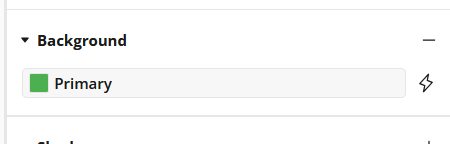

### 3.3. Новый стиль

Создал новый стиль для кнопки, использующий переменную `primary-color`. Применил стиль к кнопкам на странице.

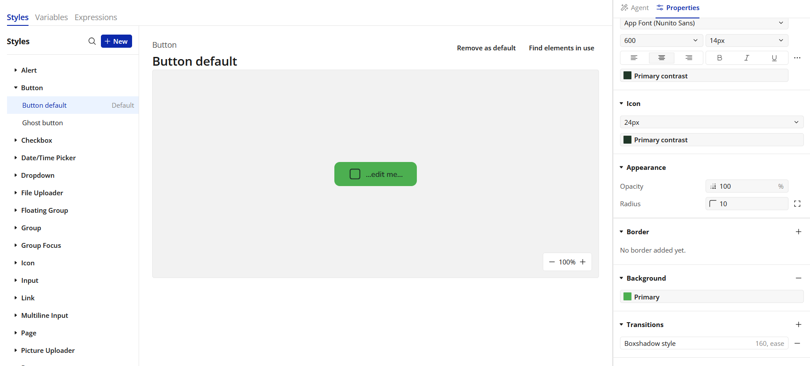

### 3.4. Готовый компонент

Добавил готовый компонент из UI Components — блок с заголовком «Дневник питания». Настроил его под свою тему (цвет, шрифт).

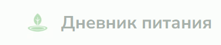
---

## Часть 4. Data и Workflows

### 4.1. Data: новая сущность

**AI-промпт:**

```
Я делаю приложение «Дневник питания» на Bubble (no-code). 
В приложении уже есть сущность «Приём Пищи». Предложи новую 
сущность (Data Type) — цель пользователя по питанию. 
Нужно минимум 3 поля разных типов (text, number, date, yes/no). 
Дай название сущности, список полей с типами и кратким описанием.
```

**Ответ AI:**

Предлагаю сущность **`Цель`** (Goal) — цели пользователя по питанию.

| Поле | Тип | Описание |
|---|---|---|
| `Название` | text | Название цели |
| `Целевые калории` | number | Норма калорий в день |
| `Целевой вес` | number | Желаемый вес, кг |
| `Дедлайн` | date | Дата достижения цели |
| `Активна` | yes/no | Активна ли цель |

Всего 5 полей 4 разных типов (text, number, date, yes/no) — 
соответствует требованию «минимум 3 поля разных типов».

**Созданная сущность в Bubble:**

Тип данных `Цель` с полями разных типов.

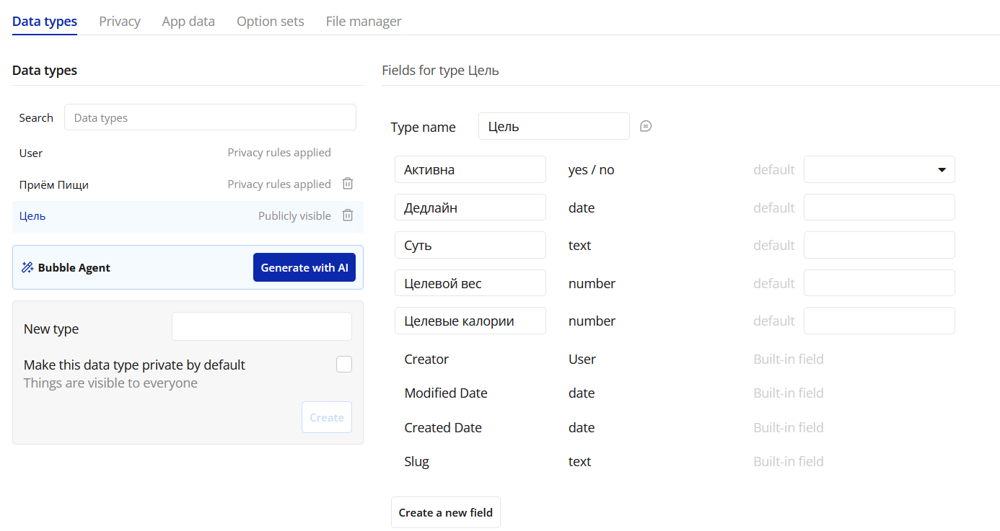

**Записи в App Data:**

Добавил 3 записи вручную.

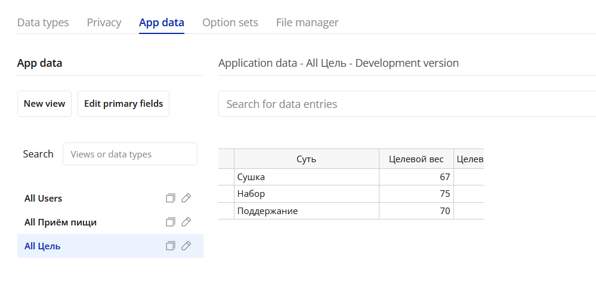

---

### 4.2. Workflows: CRUD

**AI-промпт для генерации UI:**

```
Создай на новой странице «goals» интерфейс для CRUD-операций 
с сущностью «Цель» (Goal). Поля: Название (text), 
Целевые калории (number), Целевой вес (number), 
Дедлайн (date), Активна (yes/no).

Нужно:
1. Кнопка «Добавить цель» — открывает Popup с формой 
   (все 5 полей).
2. Repeating Group со списком всех целей — в каждой ячейке 
   название, калории, вес, дедлайн, статус «активна», 
   кнопки «Редактировать» и «Удалить».
3. Кнопка «Редактировать» открывает тот же Popup с 
   заполненными полями.
4. Кнопка «Удалить» удаляет запись.
```

**Реализованные workflows:**

- **Create**: кнопка «Добавить» → Show Popup → Create a new thing (Цель).
- **Read**: Repeating Group с `Search for Цельs`, фильтр `Created by = Current User`.
- **Update**: кнопка «Редактировать» → Display data → Show Popup → Make changes to a thing.
- **Delete**: кнопка «Удалить» → Delete a thing.

**Скриншоты:**

**Create (создание записи):**
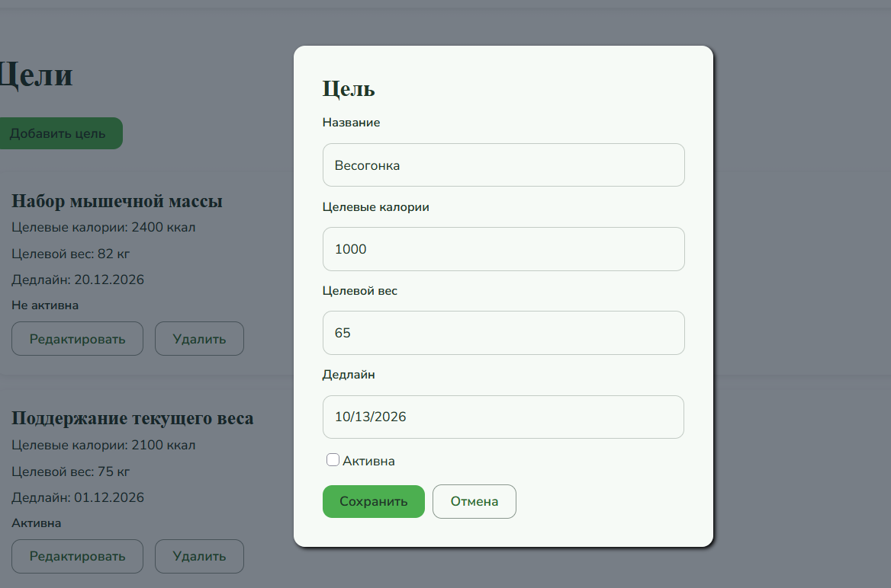

**Update (редактирование записи):**
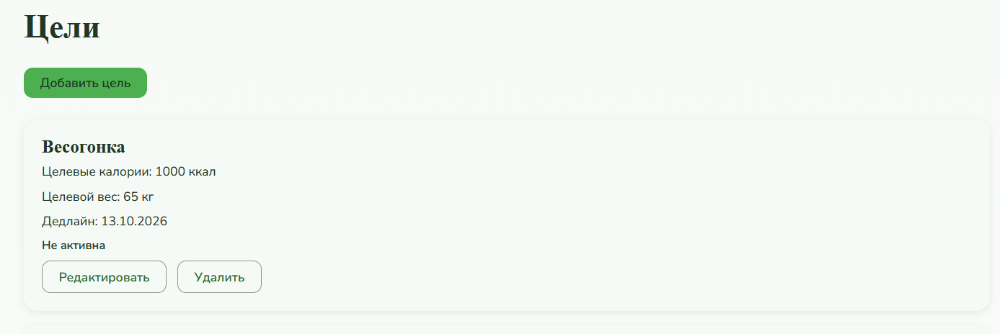

**Delete (удаление записи):**
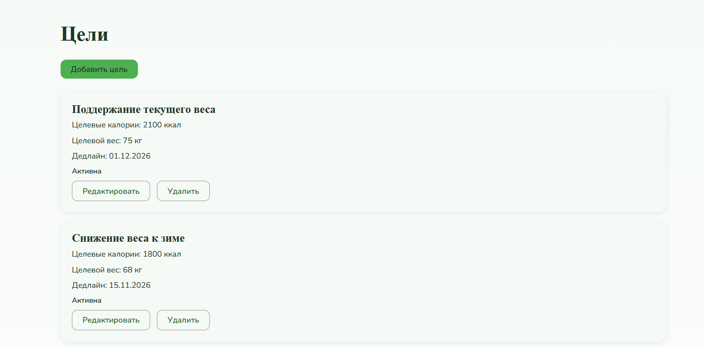

## Часть 5. Ачивка Plugins
**Плагин:** Progress Bar.

**Что сделано:**

Установил плагин Progress Bar, добавил элемент на страницу 
`goals`. Создал 3 Custom State: `eatenCalories`, 
`targetCalories`, `caloriesPercent`. В workflow Page is loaded 
настроил 3 действия Set state, которые считают сумму калорий, 
целевые калории и процент. ProgressBar в поле `Percentage` 
получает `goals's caloriesPercent`.

**Скриншоты:**

**Progress Bar в редакторе:**
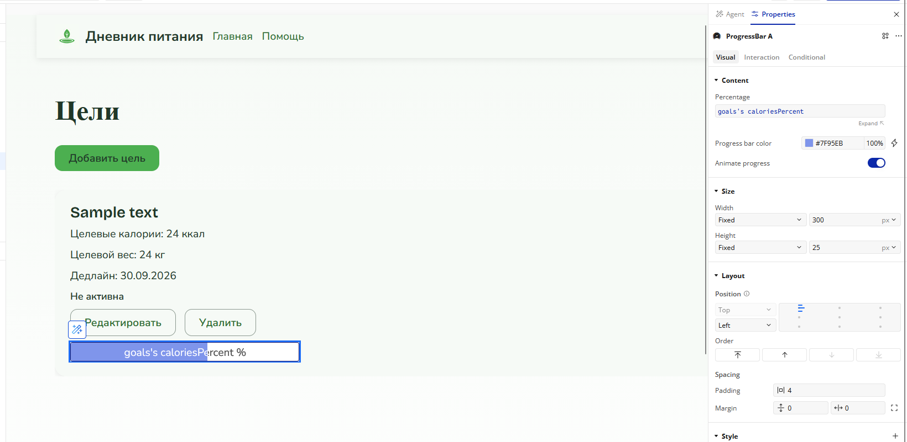

**Progress Bar в Preview:**
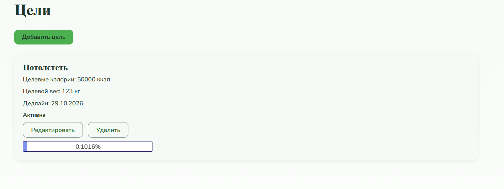
