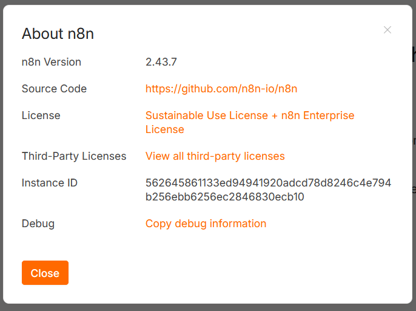
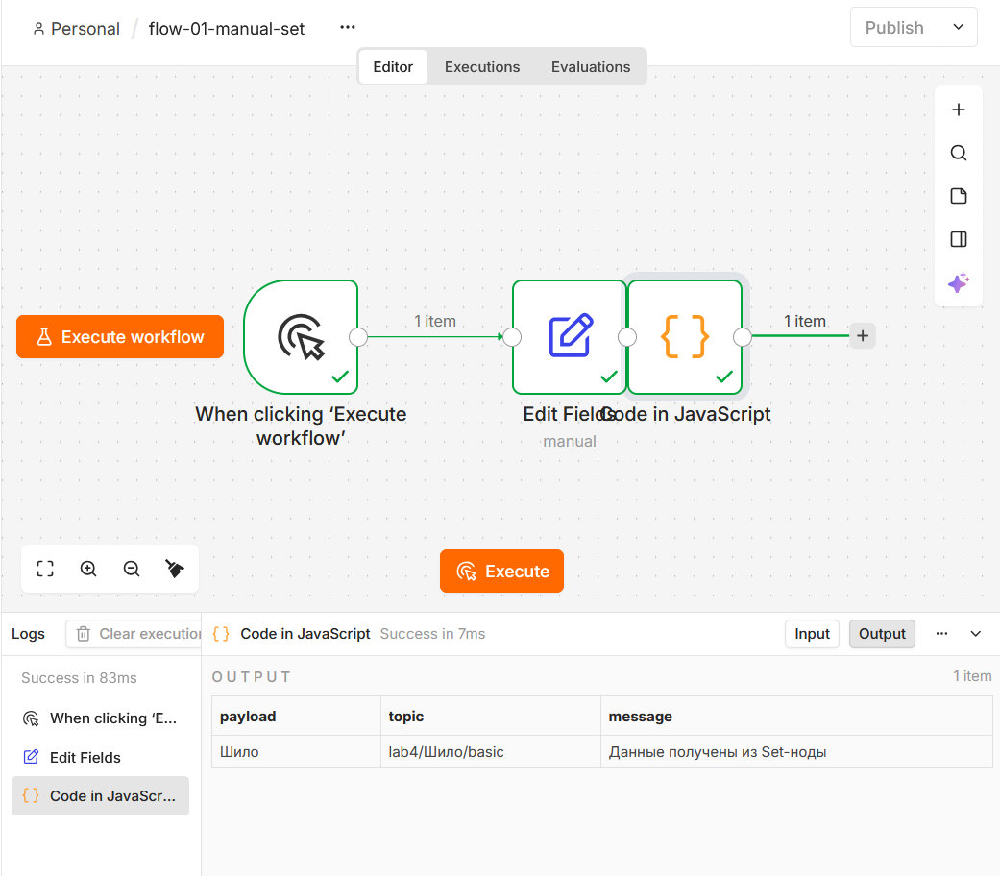
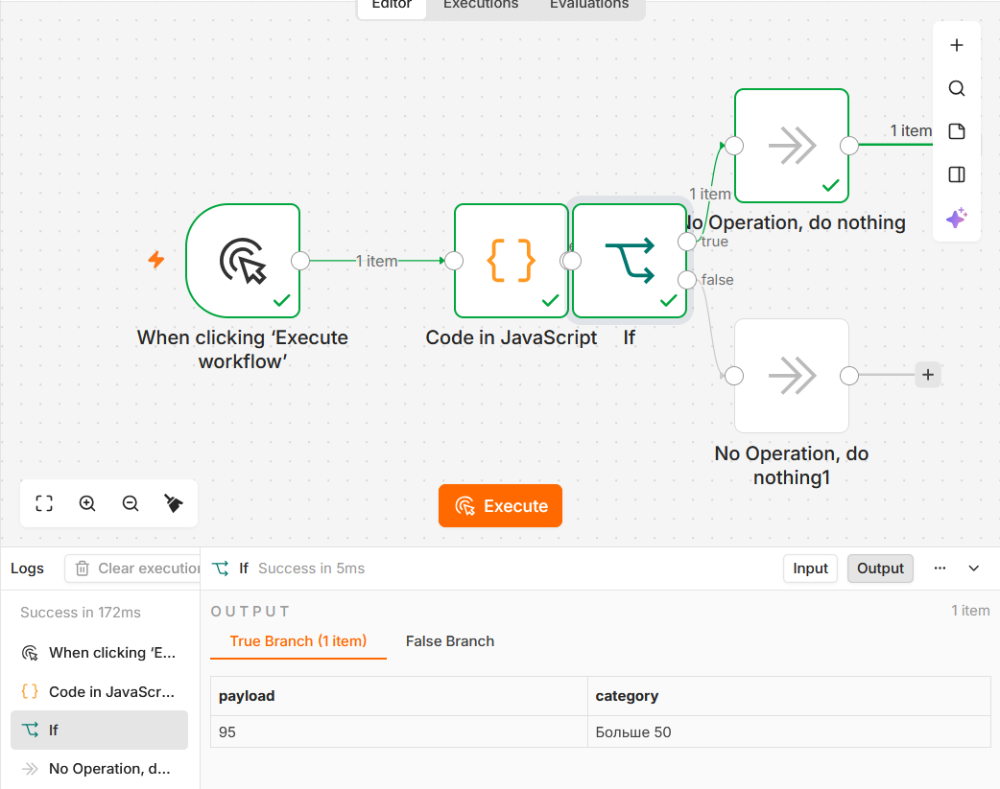
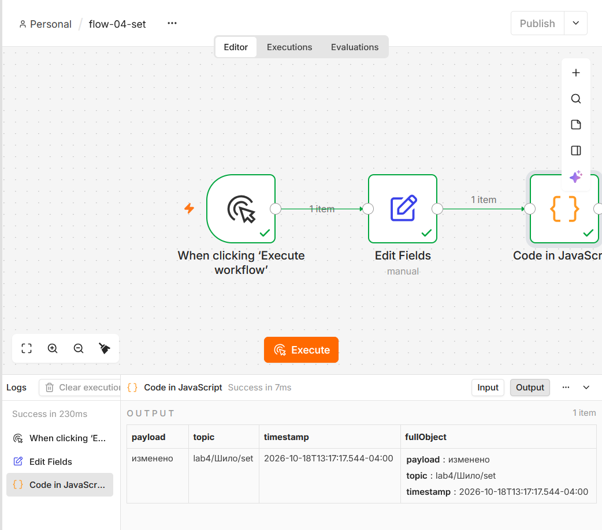
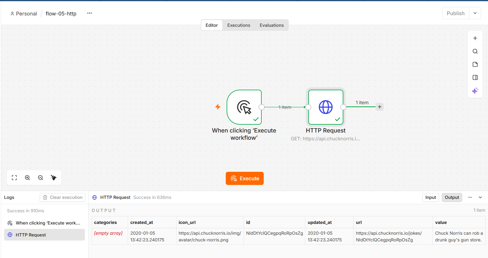
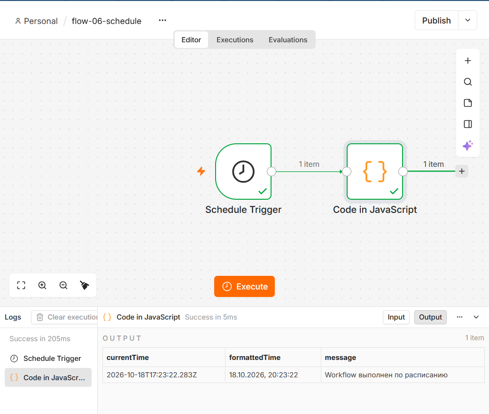
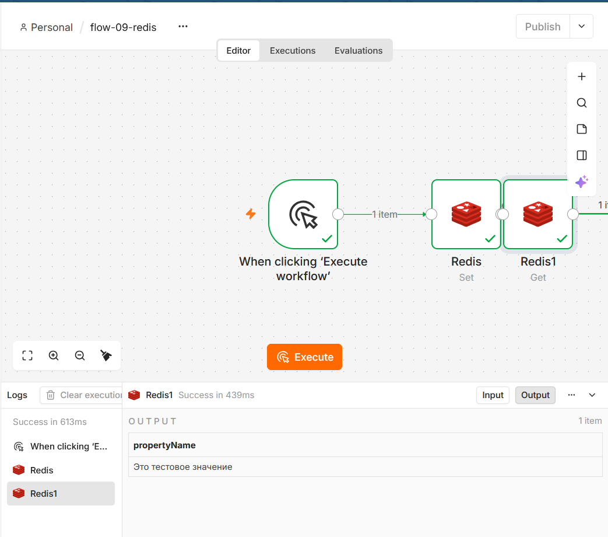
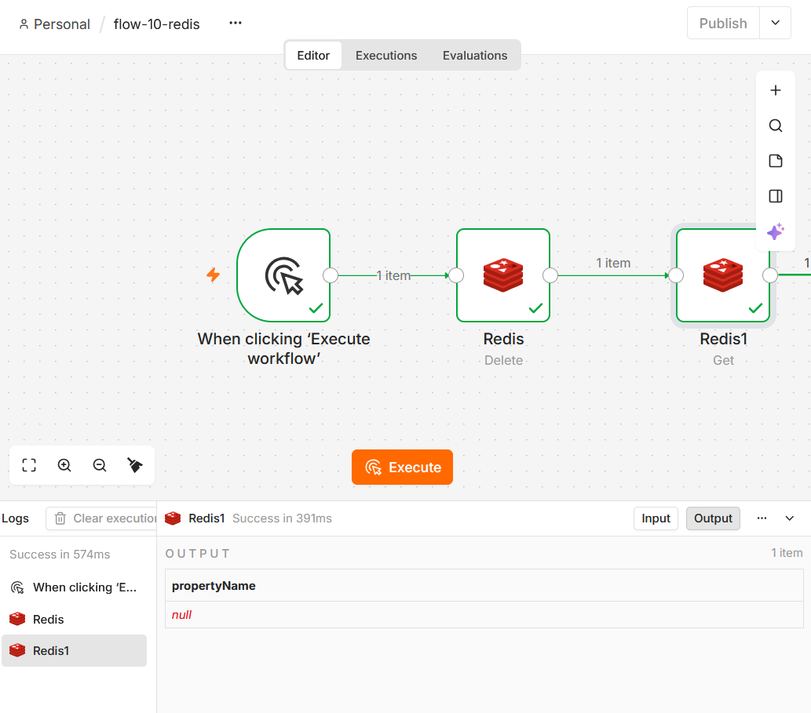
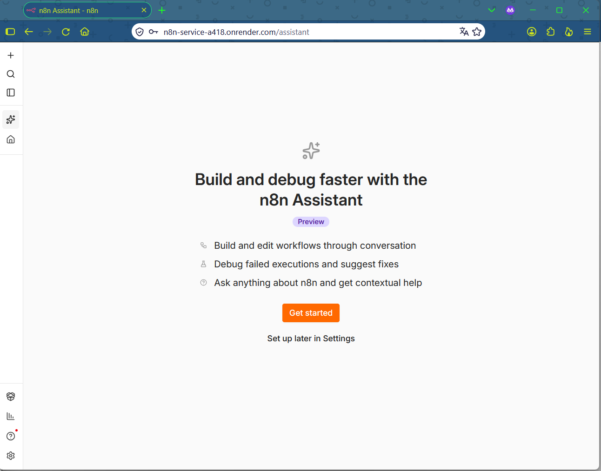
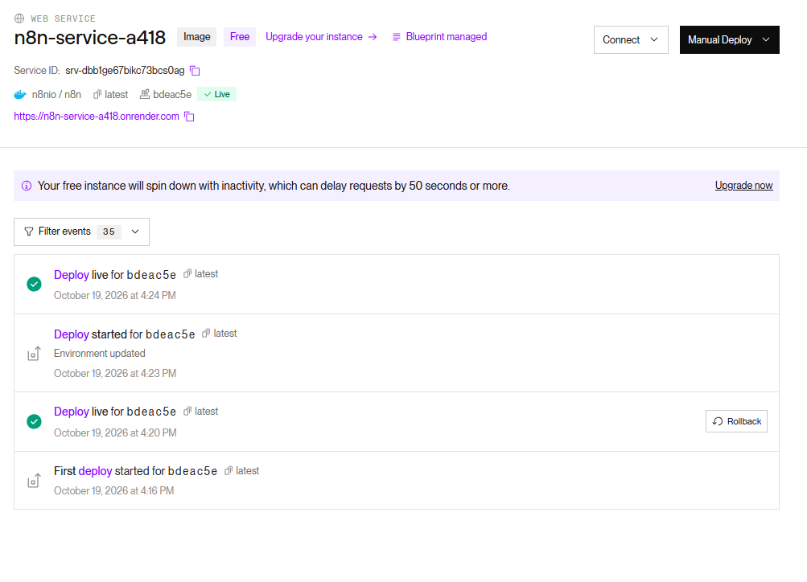

# Отчёт по лабораторной работе №4 (n8n)

**Студент:** Шило Денис  
**Группа:** УИР-241  
**Дата:** 19.10.2026

**Ачивка:** 6 — Бесплатный деплой n8n в интернет

---

## Часть 1. Установка и запуск n8n

**Способ установки:** npm (Docker на компьютере не работает из-за конфликта виртуализации с VMware и ошибки 0x80073712).

**Версия n8n:** v2.43.8  

**Запуск:**
```bash
npm install n8n -g
n8n start
```

Локальное приложение доступно по адресу `http://localhost:5678`.



---

## Часть 2. Изучение нод и создание workflow

### 2.1. Manual Trigger → Set → Code

Собрал workflow из трёх нод: Manual Trigger, Set (задаёт `payload` и `topic`), Code (выводит в консоль).
Экспорт: `flows/flow-01-manual-set.json`.



### 2.2. Code node

Собрал workflow Manual Trigger → Code → NoOp. В Code использованы `const`, `let`, `for`, массив, объект, `if/else`.
Экспорт: `flows/flow-02-code.json`.


### 2.3. IF node

Собрал workflow Manual Trigger → Code → IF → (true) NoOp / (false) NoOp. IF настроен по `payload > 50`.
Экспорт: `flows/flow-03-if.json`.



### 2.4. Set node (изменение полей)

Собрал workflow Manual Trigger → Set → Code. Set задаёт `topic`, `timestamp`, `payload`. Code выводит полный объект.
Экспорт: `flows/flow-04-set.json`.



### 2.5. HTTP Request node

Собрал workflow Manual Trigger → HTTP Request → Code. Использован API `https://api.chucknorris.io/jokes/random`.
Экспорт: `flows/flow-05-http.json`.



### 2.6. Schedule Trigger

Собрал workflow Schedule Trigger → Code. Запуск каждую минуту, Code возвращает текущее время.
Экспорт: `flows/flow-06-schedule.json`.



---

## Часть 3. Redis: создание и удаление ключа

В задании предлагалось установить Redis через Docker. Так как Docker не работает, использовал 
**облачный Redis от Upstash** (бесплатный тариф). Описание — в `docs/redis.md`.

### Workflow 1: создание и чтение

Manual Trigger → Redis (Set, ключ `shilo`) → Redis (Get).
Экспорт: `flows/flow-09-redis.json`.



### Workflow 2: удаление и проверка

Manual Trigger → Redis (Delete, ключ `shilo`) → Redis (Get — возвращает пустое значение, значит ключ удалён).
Экспорт: `flows/flow-10-redis.json`.



---

## Ачивка 6. Бесплатный деплой n8n в интернет

**Способ:** Render (бесплатный тариф).

**Что сделано:**
1. Зарегистрировался на [render.com](https://render.com/).
2. Форкнул официальный шаблон `render-examples/n8n`.
3. Создал Blueprint — Render автоматически развернул Web Service (n8n) и PostgreSQL (база данных).
4. Настроил переменные окружения для доступа к базе данных и пароля входа.
5. Дождался деплоя (5–10 минут) и открыл публичный URL во вкладке инкогнито, тк в обычной долго грузило.

**Публичный URL:** `https://n8n-service-a418.onrender.com`

**Ограничения бесплатного тарифа:**
- Сервис «засыпает» после 15 минут бездействия. Первый запрос после сна занимает 30–60 секунд.
- 750 часов работы в месяц.





---

## Освоенные ноды

Manual Trigger, Schedule Trigger, Set, Code, IF, NoOp, HTTP Request, Redis (Set, Get, Delete).

---

## Использованные AI-промпты (примеры)

- «Как собрать workflow с Manual Trigger → Set → Code в n8n?»
- «Как вывести полный объект msg в Code-ноде n8n?»
- «Как подключить облачный Redis (Upstash) к n8n?»
- «Как задеплоить n8n на Render бесплатно с базой данных?»

---

## Выводы

В ходе лабораторной работы я освоил n8n как low-code платформу автоматизации. 
Научился устанавливать его через npm (так как Docker не работает), собирать workflow из базовых нод: 
Manual Trigger, Set, Code, IF, NoOp, HTTP Request, Schedule Trigger. 
Отдельно разобрался с Redis: подключил облачную базу от Upstash, реализовал создание, чтение и удаление ключа. 
Также выполнил ачивку №6 — задеплоил n8n на бесплатный хостинг Render с базой данных PostgreSQL, 
получил публичный URL. Главная сложность — ограничения бесплатных тарифов (спящий режим, лимит на базы данных), 
но для учебных задач этого достаточно.
