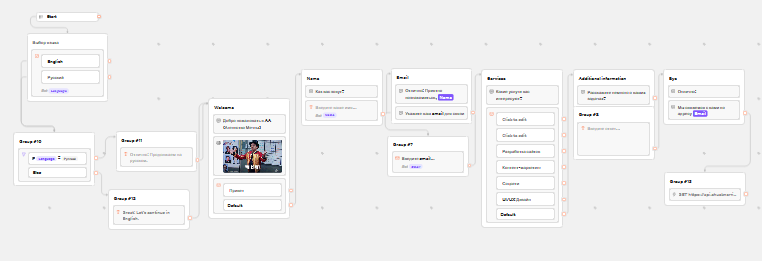
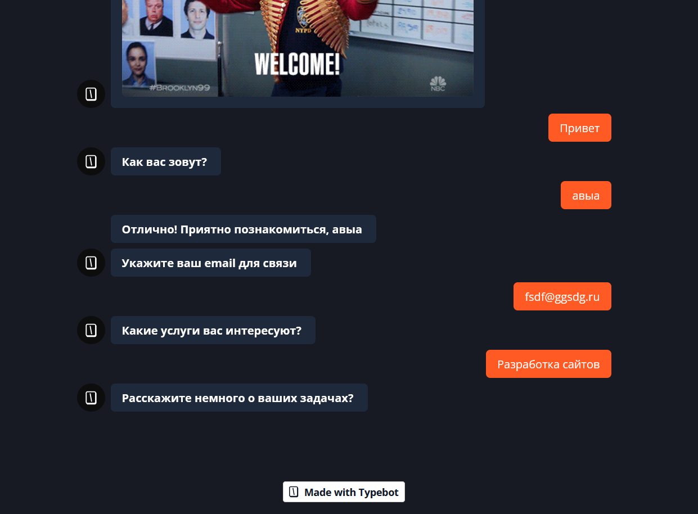

# Отчёт по лабораторной работе №5 (TypeBot)

**Студент:** Шило Денис  
**Группа:** УИР-241

**Трек:** C — TypeBot

## Часть 1. Выбор трека и перевод шаблона

Выбрал трек C (TypeBot), так как ManyChat недоступен в моём регионе, а Botpress перешёл на интерфейс Vibe без визуального редактора.

Создал бота на основе шаблона **Lead Generation**. Перевёл все тексты, кнопки и описания на русский язык.

### Часть 2. Логика, переменные и интеграции

Добавил в шаблон:
- Переменную `Language` для сохранения выбора пользователя.
- Условие (Condition) для ветвления по языку.
- Интеграцию HTTP Request (запрос к публичному API).
- Изменена тема оформления.

**Ссылка на бота:** [https://typebot.co/lab5-bot-lced5xv]
### Результат работы бота

**Общий вид флоу в редакторе Typebot:**

**Пример диалога с ботом (интерфейс чата):**

