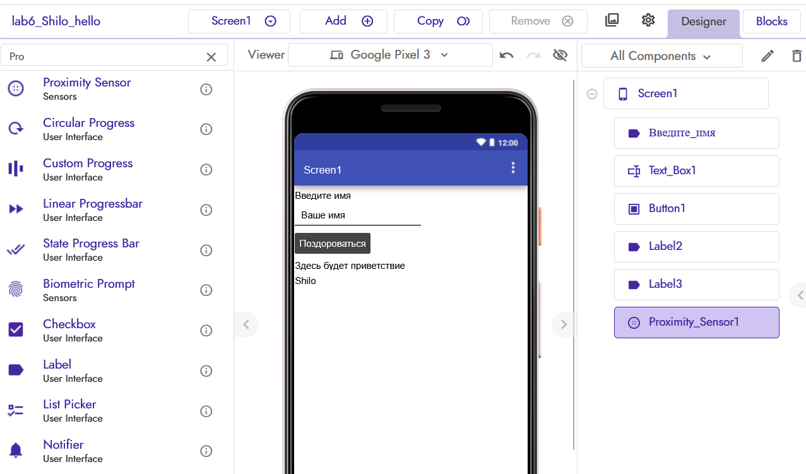
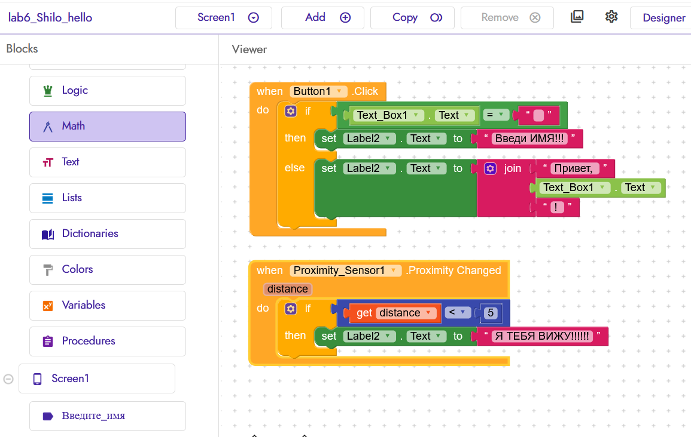
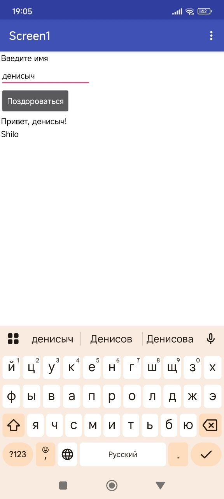
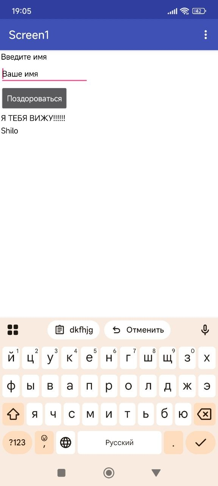

# Отчёт по лабораторной работе №6 (Kodular)

**Студент:** Шило Денис  
**Группа:** УИР-241  
**Проект:** lab6-Шило-hello

## 1. Краткое описание приложения

Базовое приложение «Приветствие» состоит из одного экрана (`Screen1`). На экране размещены: заголовок, текстовое поле для ввода имени, кнопка «Поздороваться», поле для вывода результата и метка с фамилией студента на английском языке (**Shilo**).

**Логика:** при нажатии на кнопку проверяется, пустое ли поле ввода. Если пусто — выводится «Введите имя!». Если введено имя — выводится «Привет, <имя>!» с использованием блока склейки строк `join`.

**Реализованная ачивка:** №12 — Датчик приближения (Proximity Sensor).

## 2. Ссылка на проект

Файл экспорта: `exports/lab6-Shilo.aia`.

## 3. Использованные AI-промпты (примеры)

- «Как в Kodular связать блок if/else с кнопкой, чтобы проверять пустое ли текстовое поле?»
- «Как использовать блок join для склейки строк в Kodular?»
- «Как добавить Proximity Sensor и обработать событие ProximityChanged в Kodular?»

## 4. Освоенные компоненты и блоки

**Компоненты:** Label, TextBox, Button, Proximity Sensor.
**Блоки:** when Button.Click, if/then/else, set Label.Text, join, when ProximitySensor.ProximityChanged, distance.

## 5. Скриншоты

### 5.1. Экран дизайнера (Designer)

Видна фамилия **Shilo** на английском языке, заголовок, поле ввода, кнопка и метка результата.

### 5.2. Логика базового задания (Blocks)

Показаны блоки: проверка условия (пустое ли поле), вывод сообщения об ошибке, вывод приветствия через `join`.

### 5.3. Результат работы: приветствие

После ввода имени и нажатия на кнопку выводится «Привет, <имя>!».

### 5.4. Ачивка 12: Датчик приближения (Proximity Sensor)

При поднесении руки к экрану (датчику) текст меняется на «Я ТЕБЯ ВИЖУ!!!».

## 6. Ограничения бесплатного тарифа Kodular

- До 10 проектов.
- До 10 МБ ассетов.
- До 5 расширений (extensions).

Для данной лабораторной работы этих лимитов достаточно.

## 7. Выводы

В ходе лабораторной работы я освоил Kodular как low-code платформу для создания Android-приложений. 
Научился работать с визуальными компонентами (Label, TextBox, Button) и 
блоками логики (условия, склейка строк). 
Реализовал базовое приложение-приветствие и дополнительную ачивку — датчик приближения. 
Главная сложность была в соединении блоков (пазлов), но после понимания структуры всё заработало.
